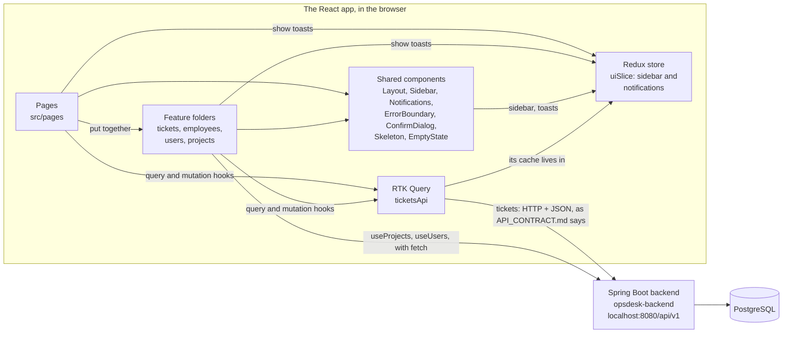
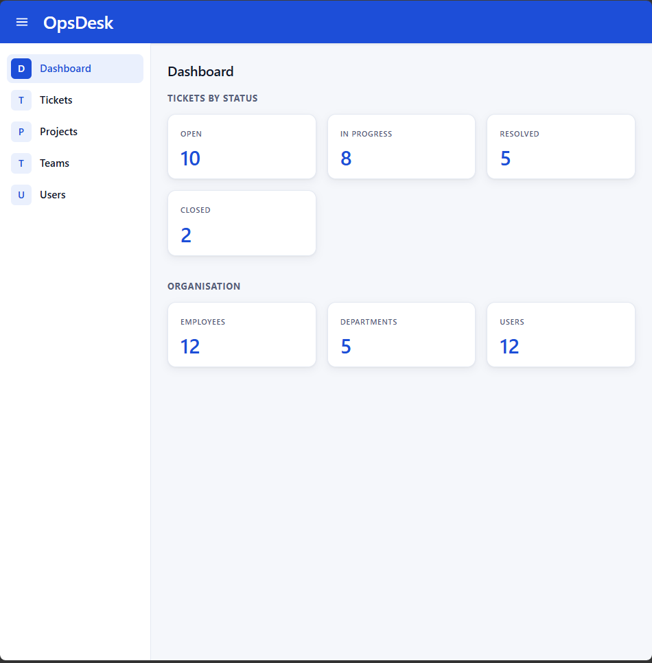
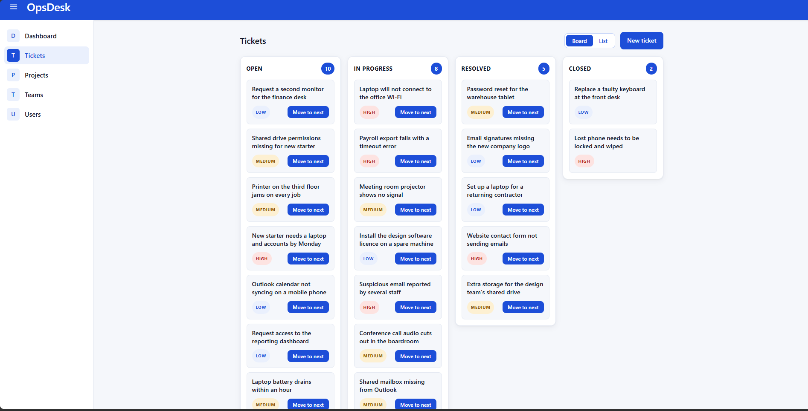
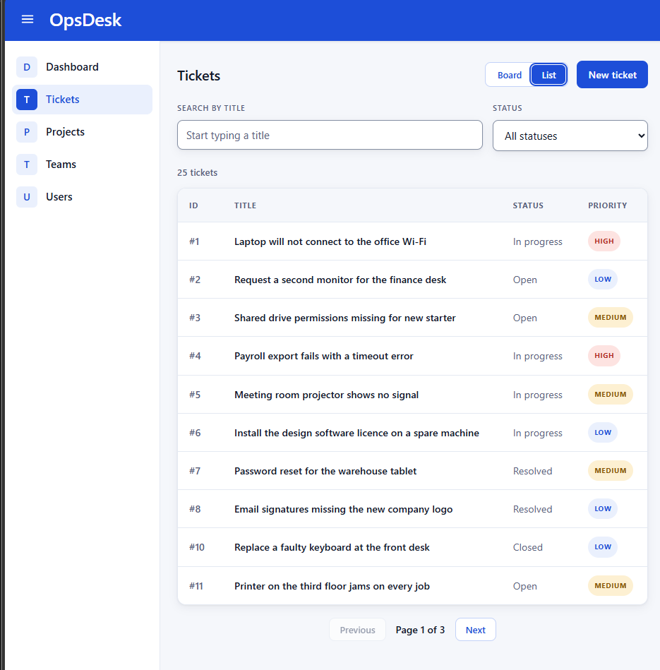
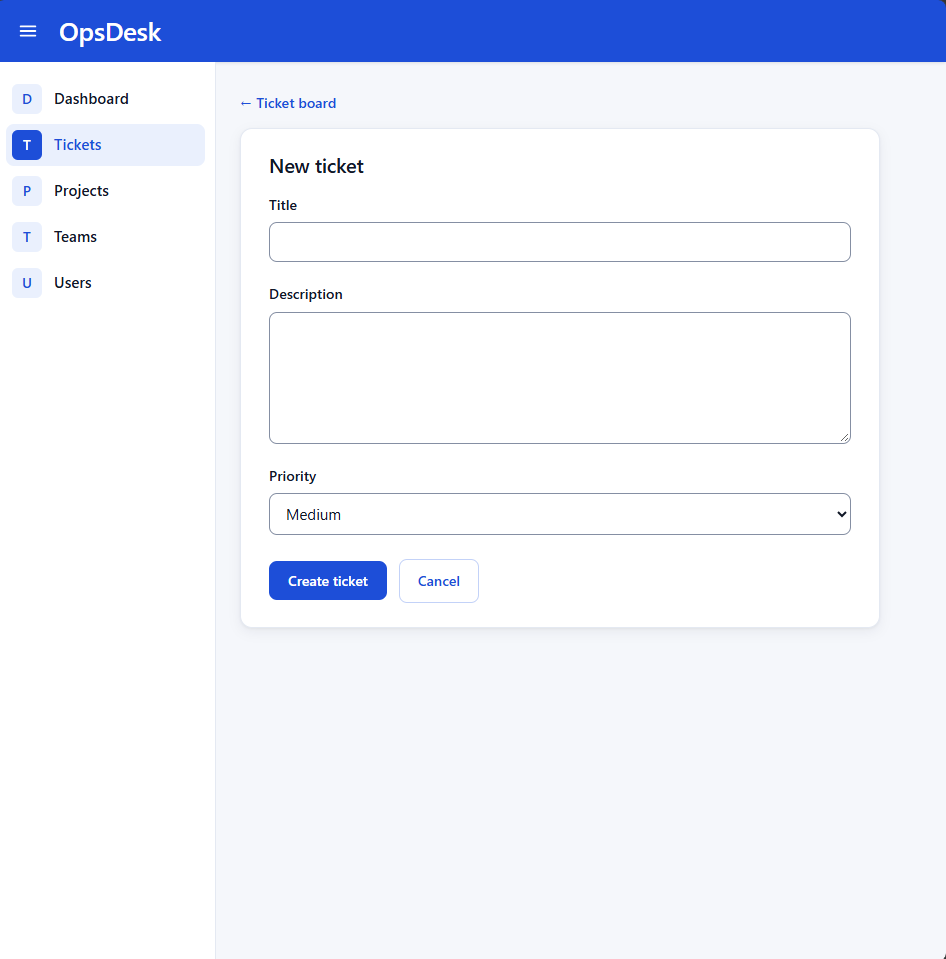
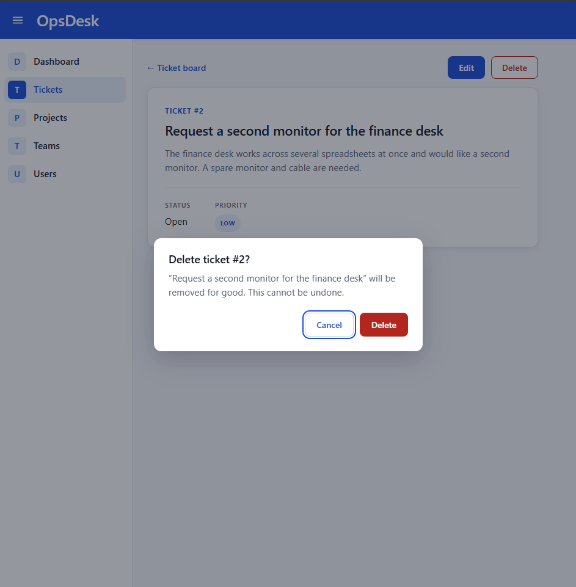
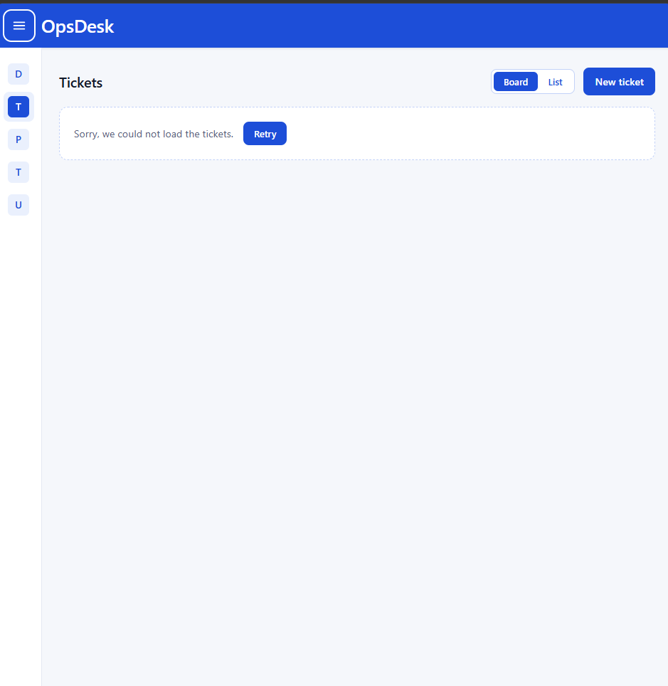
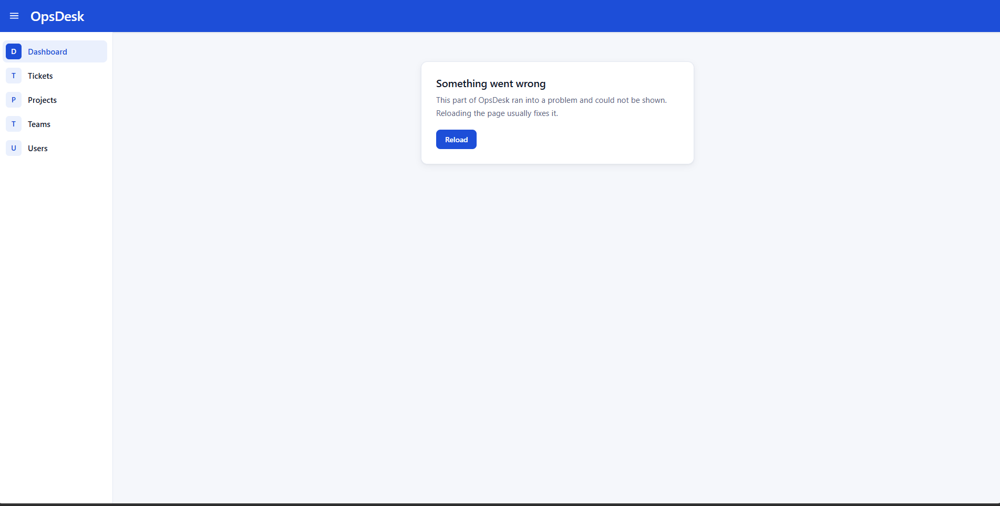

# OpsDesk

OpsDesk is an internal operations dashboard for an IT support team. It brings
together what a support team needs day to day: a board of support tickets, a
staff directory, internal projects and a list of user accounts. They sit behind
one set of navigation, with a dashboard summarising them.

This repository is the frontend, version 1.0. It was built as an internship
project with React, TypeScript and plain CSS. There is no UI framework, so the
underlying React ideas stay visible. Its data comes from the Spring Boot
backend, [opsdesk-backend](https://github.com/Jesutofunmiabby/opsdesk-backend),
and both follow the same [API contract](API_CONTRACT.md).

## Contents

- [Features](#features)
- [Tech stack](#tech-stack)
- [Getting started](#getting-started)
- [Environment variables](#environment-variables)
- [Running the tests](#running-the-tests)
- [Architecture](#architecture)
- [The API](#the-api)
- [Screenshots](#screenshots)
- [Accessibility](#accessibility)
- [Folder structure](#folder-structure)
- [Troubleshooting](#troubleshooting)
- [What's next](#whats-next)
- [Project conventions](#project-conventions)

## Features

- **Dashboard.** Cards showing how many tickets are Open, In progress,
  Resolved and Closed, and how many employees, departments and user accounts
  there are. Each count comes from the server, so it stays right however many
  tickets there are.
- **Ticket board.** Four columns, one per status. Each ticket shows its title
  and a colour-coded priority: blue for LOW, amber for MEDIUM, red for HIGH.
  **Move to next** moves a ticket on to the next status.
- **Ticket list.** A table with a title search, a status filter, and 10
  tickets to a page with Previous and Next. The server does the searching,
  filtering and paging, and the search waits until typing pauses before it is
  sent.
- **Ticket pages.** Every ticket has its own page and URL. From there it can be
  edited, or deleted after a confirmation dialog.
- **Create and edit forms.** One form for both. It checks the title (3 to 120
  characters), the description (required) and the priority, and shows each
  problem under its field.
- **Feedback.** Success and failure notifications ("toasts") after every
  create, edit, move and delete. Buttons are disabled while their request
  runs, so nothing is sent twice.
- **Loading, empty and error states.** Every screen that loads data shows a
  skeleton shaped like the real content while it loads. It shows a helpful
  message when there is nothing to show, and an error with a Retry button when
  the request fails.
- **Error boundary.** If a page crashes, a friendly message with a Reload
  button replaces just that page, and the header and sidebar keep working.
- **Projects, Teams and Users.** Internal IT projects with their owner, status
  and due date, from the backend. A searchable employee directory with a
  details panel. User accounts with their job title and role, from the
  backend.
- **Collapsible sidebar.** It folds down to a narrow bar of letters.
- **Routing.** Every page has its own URL, so Refresh, Back, Forward and
  bookmarks all work. An unknown address shows a Not Found page.

## Tech stack

| Area | Tool |
|------|------|
| UI | [React](https://react.dev) 19 with TypeScript |
| Build and dev server | [Vite](https://vite.dev) |
| Routing | [React Router](https://reactrouter.com) |
| Shared UI state | [Redux Toolkit](https://redux-toolkit.js.org) (`uiSlice`) |
| Server data | RTK Query (`ticketsApi`), part of Redux Toolkit |
| Mock API for the tests | [MSW](https://mswjs.io) (Mock Service Worker) |
| Tests | [Vitest](https://vitest.dev), [React Testing Library](https://testing-library.com/docs/react-testing-library/intro/), user-event, jsdom |
| Linting | [Oxlint](https://oxc.rs) |
| Styling | Plain CSS, with every colour in variables in `src/index.css` |

## Getting started

You need [Node.js](https://nodejs.org), an LTS release. It was developed on
version 22.

The app needs the backend running. Start it first, as its
[README](https://github.com/Jesutofunmiabby/opsdesk-backend#readme) explains:
PostgreSQL with `docker start opsdesk-db`, then `./mvnw spring-boot:run` in
the opsdesk-backend folder. It answers at <http://localhost:8080/api/v1>.

Then, in this folder:

```bash
git clone https://github.com/Jesutofunmiabby/opsdesk-frontend.git
cd opsdesk-frontend
npm install              # install the dependencies, once
cp .env.example .env     # create your own settings file (see below)
npm run dev              # start the dev server
```

Then open <http://localhost:5173/>. Vite prints the address when it starts.
Use `localhost` rather than `127.0.0.1`, and keep port 5173: the backend only
accepts requests from the app at `http://localhost:5173` (see CORS in
[API_CONTRACT.md](API_CONTRACT.md)).

Every ticket, project and user comes from the backend and is saved in its
PostgreSQL database, so changes survive a restart and are seen by everyone
using that backend.

### All the commands

| Command | What it does |
|---------|--------------|
| `npm run dev` | Starts the dev server. It talks to the backend at `VITE_API_URL`. |
| `npm test` | Runs the tests and watches for changes. |
| `npm test -- --run` | Runs the tests once and stops. |
| `npm run typecheck` | Checks the TypeScript types. |
| `npm run lint` | Checks the code with Oxlint. |
| `npm run build` | Type checks, then makes the production build in `dist/`. |
| `npm run preview` | Serves the production build from `dist/`, at <http://localhost:4173/>. |

`npm run preview` shows the build exactly as it would ship. It runs on port
4173, so the backend has to allow that address too: start the backend with
`CORS_ALLOWED_ORIGINS=http://localhost:5173,http://localhost:4173`.

## Environment variables

Settings live in a `.env` file in the project folder. Git ignores it, so each
person keeps their own. [`.env.example`](.env.example) lists every setting
with an explanation: copy it to `.env` to start.

| Variable | Default | What it does |
|----------|---------|--------------|
| `VITE_API_URL` | `http://localhost:8080/api/v1` | Where the backend API lives, including the version. The default is the backend running on your computer. For a deployed backend, use its address, for example `https://api.example.com/api/v1`. A path like `/api/v1` means "on the same server as the app". |

Never put passwords, secret keys or tokens in `.env`. Every `VITE_` variable
is built into the JavaScript sent to the browser, so anyone using the app can
read it.

Vite reads `.env` when it starts, and a build keeps the values it was built
with. After editing `.env`, restart `npm run dev`, or build again.

## Running the tests

```bash
npm test -- --run
```

There are 53 tests in 12 files. They run in jsdom, a pretend browser, so no
real browser is needed, and no backend either. Test files sit next to the code
they test, named `*.test.ts` or `*.test.tsx`.

The tests talk to an MSW mock API through `setupServer`. It catches the app's
real requests inside Node and answers exactly as the contract says, so the
tests are fast and give the same answers every time. A single test can swap in a different answer
(an empty list, a server error) with `server.use(...)`. The
`renderWithProviders` helper in `src/test/` gives every test a fresh Redux
store and a router.

| What is tested | Where |
|----------------|-------|
| The mock API answers exactly as the contract says: the error shape, paging from 0, validation, status codes, ids never reused | `src/mocks/handlers.test.ts` |
| The tickets page's loading, empty and error states | `src/pages/TicketsPage.test.tsx` |
| Creating a ticket through the form, and the form's errors | `src/pages/NewTicketPage.test.tsx` |
| Deleting a ticket: Cancel and Escape keep it, confirming deletes it. A missing ticket, and a failed load | `src/pages/TicketDetailPage.test.tsx` |
| The list's status filter, Clear filters, pages shown from 1, and its empty state | `src/features/tickets/components/TicketList.test.tsx` |
| The list's filter helper | `src/features/tickets/utils/ticketList.test.ts` |
| The Projects page: loading, the projects from the API, and a failed load | `src/features/projects/components/ProjectList.test.tsx` |
| The Users page: the users from the API with their roles, an empty job title, and a failed load | `src/features/users/components/UserList.test.tsx` |
| The ticket card's link | `src/features/tickets/components/TicketCard.test.tsx` |
| The confirmation dialog | `src/components/ConfirmDialog.test.tsx` |
| The error boundary catching a crash | `src/components/ErrorBoundary.test.tsx` |
| The skip link | `src/layouts/Layout.test.tsx` |

Each test was checked by breaking the feature it covers and watching it fail.

## Architecture



How to read it:

- **Pages** are thin. Each one puts feature components and shared components
  together for one URL.
- **Feature folders** hold everything about one subject: its components,
  hooks, helpers, types and any static data.
- **The Redux store** holds only shared UI state, through `uiSlice`: whether
  the sidebar is collapsed, and the list of notifications. Ticket data is
  never kept in a Redux slice.
- **RTK Query (`ticketsApi`)** is the only way the app gets or changes
  tickets. It caches each answer, shares it between screens, and refreshes
  the right lists after a change. Its cache is kept inside the store.
- **The backend** answers every request at `VITE_API_URL` and keeps the data
  in PostgreSQL. Projects and users are read with `useFetch`, through the
  `useProjects` and `useUsers` hooks.
- **The MSW mock API** (`src/mocks/`) is used only by the tests. It answers as
  the backend does, so the tests need no backend running.

## The API

[API_CONTRACT.md](API_CONTRACT.md) is the source of truth for the API. It
covers:

- the general rules: everything under `/api/v1`, JSON, numeric ids that are
  never reused, and ISO 8601 dates;
- the one error shape every error uses:
  `{ "error": "VALIDATION_ERROR", "message": "...", "fields": { ... } }`;
- the paged list shape, `{ items, page, size, totalItems, totalPages }`, with
  pages counted from 0;
- every endpoint for tickets, projects, users and auth, with its status
  codes and examples;
- a security review.

If the mock API and the contract ever disagree, the mock API is wrong, and
the contract tests in `src/mocks/handlers.test.ts` are there to catch that.

## Screenshots

The images live in [`docs/screenshots/`](docs/screenshots/).

| Dashboard | Ticket board |
|-----------|--------------|
|  |  |

| Ticket list | Create form |
|-------------|-------------|
|  |  |

| Delete confirmation | Error state |
|---------------------|-------------|
|  |  |

| Error boundary |
|----------------|
|  |

## Accessibility

The whole app can be used with a keyboard alone:

- every link, button and form control can be reached with **Tab**;
- each one is used with **Enter** (and **Space** for buttons);
- each one shows a solid blue focus ring when it has keyboard focus.

Every form control has a text label, and every clickable thing is a real
`<button>` or link. The app has no images that would need alt text.

Fixes made while checking this:

- **Skip link.** There was no way past the navigation: a keyboard user had to
  tab through the menu button and all five sidebar links on every page before
  reaching its content. A "Skip to main content" link is now the first thing
  Tab reaches. It is hidden until focused, and pressing it moves focus into the
  page. A test checks that it does.
- **Placeholder contrast.** The placeholder text in the ticket search and the
  employee search was faded to 70%, giving a contrast of about 3.2:1 against
  white, below the 4.5:1 that text needs. It is now full strength, about
  6.3:1.
- **Form focus ring.** Form fields showed focus with only a faint blue wash.
  On a field with an error the red border stayed and the wash turned a faint
  red, so a focused field looked almost the same as an unfocused one. Fields
  now use the same solid blue focus ring as every other control, and a field
  with an error keeps its red border as well.
- **Form field borders.** Field borders were too faint to see easily. They
  were darkened to meet the 3:1 contrast that the edges of controls need.
- **Board column counts.** The number beside each column heading was read out
  on its own, as just "3". Hidden text now makes it "3 tickets" for screen
  readers, with no change on screen.
- **Headings.** The board's column headings are one level below the page
  title, so the page's outline makes sense to screen reader users.
- **Email links.** The email links on the Users page and in the employee
  details panel had only the browser's default focus outline. They now use the
  app's blue focus ring like everything else.
- **Confirmation dialog.**
  - Focus moves into the dialog and stays there while it is open. Tab cannot
    wander to the page behind it.
  - Escape closes the dialog, and so does Cancel.
  - Either way, focus goes back to the button that opened it.
- **Loading states.** Screen readers announce a skeleton by its label, such
  as "Loading tickets…", and skip its empty shapes. A list that is being
  refreshed is marked as busy.

## Folder structure

```
src/
  main.tsx           entry point: renders the app inside the error
                     boundary, the Redux store and the router
  App.tsx            the app itself: its routes
  config.ts          reads VITE_API_URL
  index.css          theme: every colour and shape variable lives here
  store/             Redux: the store, uiSlice (sidebar and notifications),
                     ticketsApi (RTK Query) and the shared API types
  mocks/             the MSW mock API for the tests, and its contract
                     tests
  features/
    tickets/         components/, hooks/, data/, utils/, types.ts
    employees/       components/, data/, utils/, types.ts
    users/           components/, hooks/, data/, types.ts
    projects/        components/, hooks/, data/, types.ts
  components/        UI shared by several features: ErrorBoundary,
                     ConfirmDialog, EmptyState, RequestError, Skeleton,
                     Sidebar, Notifications, FormField, SkipLink, StatCard
  hooks/             shared hooks: useFetch, useDebouncedValue
  utils/             shared helpers: dates, getInitials
  layouts/           Layout: the blue header, sidebar and page area
  routes/            AppRoutes: every URL and the page it shows
  pages/             thin pages that put feature components together
  test/              renderWithProviders, the test helper
docs/
  screenshots/       the images in this README
```

The guiding rule is **keep each feature together**. Everything about tickets
lives in `features/tickets/`: its components, hooks, mock data, helpers and
types. Only code that more than one feature uses goes in the shared
`components/`, `hooks/` and `utils/` folders.

Inside a feature:

- **`utils/`**: plain functions with no React. Given the same input they
  return the same output: `filterTickets`, `paginate`, `validateTicket`,
  `getNextStatus`.
- **`hooks/`**: logic that *does* need React.
  - `useTicketFromUrl` reads the ticket id from the URL and loads that ticket.
  - `useTicketCounts` gets the dashboard's counts.
  - `useProjects` and `useUsers` load the projects and users from the
    backend.
- **`components/`**: the feature's pieces, from a single card up to a whole
  board or list.
- **`types.ts`**: the TypeScript types for the feature's data.

## Troubleshooting

**Every page says it could not load, with Retry.** The backend is not
answering. Check that PostgreSQL is running (`docker ps` lists
`opsdesk-db`) and that `./mvnw spring-boot:run` is still running in the
opsdesk-backend folder, then press Retry.

**The console says a request was "blocked by CORS policy".** The backend did
not allow the address the app is running on. Open the app at
<http://localhost:5173/>, not `127.0.0.1` or another port, or add that
address to the backend's `CORS_ALLOWED_ORIGINS`.

**The console still mentions `mockServiceWorker.js`.** An older version of the
app registered a mock service worker in this browser. Remove it: DevTools,
then Application, then Service workers, then Unregister, and reload.

**I changed `.env` and nothing happened.** Vite reads `.env` only when it
starts. Stop `npm run dev` with Ctrl+C and start it again. For a build, run
the build again: a build keeps the values it was made with.

**Under `npm run preview` every page says it could not load.** The preview
runs on port 4173, which the backend does not allow by default. Start the
backend with `CORS_ALLOWED_ORIGINS=http://localhost:5173,http://localhost:4173`.

**The page will not load at `127.0.0.1:5173`.** Use
<http://localhost:5173/> instead. The dev server listens on `localhost`.

## What's next

- **Week 8: login.** Register and log in, using the auth endpoints already
  described in the contract, so each request says who is asking.

## Project conventions

**Design.** Light theme, white surfaces, blue accents. Every colour comes from
the variables in `src/index.css`, with no hard-coded colours in component
styles, so the whole app can be re-themed from one place. Ticket priority
labels are colour-coded: blue for LOW, amber for MEDIUM, red for HIGH.

**Dependencies.** No new npm packages without discussing it first.

**TypeScript.** All new code is TypeScript. `any` is never used to silence an
error.

**Security.** No passwords, keys or tokens in the code or `.env` files, and no
`dangerouslySetInnerHTML`. See the Security section of
[API_CONTRACT.md](API_CONTRACT.md).

**Safety.** Every destructive action, such as deleting a ticket, asks for
confirmation first.

**Git workflow.** Nothing is committed straight to `main`. Every change goes
through a GitHub issue, then a feature branch, then a pull request. Commits are
kept small, with messages saying what changed.

**Components.** Small and focused, one component per file.
